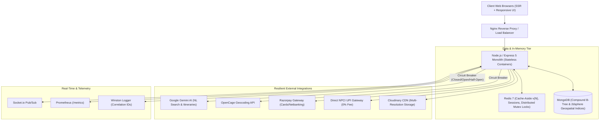

# 🏡 RoamHaven — Unified Multi-Category Accommodation & Co-Living Platform

[](https://github.com/akshatraikar11/RoamHaven/actions/workflows/ci.yml)
[](https://nodejs.org/)
[](https://expressjs.com/)
[](https://www.mongodb.com/)
[](https://redis.io/)
[](https://www.apollographql.com/)
[](https://prometheus.io/)
[](https://trivy.dev/)
[](https://jestjs.io/)
[](LICENSE)

**RoamHaven** is an enterprise-grade, high-throughput accommodation and co-living platform built with Express 5, MongoDB, Redis, and Apollo GraphQL. It provides a single unified interface for discovering, booking, and managing **PGs (Paying Guest accommodations), Hostels, Hotels, and Short-Term Vacation Stays**.

Engineered with production-grade distributed system design patterns, including **Redis-backed Idempotency Keys**, **Finite State Machine Circuit Breakers**, **$O(1)$ Cache-Aside Namespace Versioning**, a **Self-Hosted NPCI UPI QR Payment Engine**, and an **Aqua Trivy / Gitleaks DevSecOps pipeline**.

---

## 🏛️ High-Level System Architecture



---

## ⚙️ Distributed System Design Patterns

### 1. Idempotency Key Engine (`utils/idempotency.js`)
* **Problem**: Network retries or concurrent double-clicks trigger duplicate bookings or double charges.
* **Solution**: Distributed mutex locking using atomic Redis `SET NX EX 120` on incoming `Idempotency-Key` or `X-Idempotency-Key` headers.
* **Mechanics**: Concurrent duplicate requests are rejected with `409 Conflict`. Successful responses are cached for 24 hours and replayed with header `X-Idempotent-Replay: true` without hitting the database or payment rail.

### 2. Finite State Machine Circuit Breakers (`utils/circuitBreaker.js`)
* **Problem**: Upstream latency spikes or outages on external APIs (Gemini LLM, OpenCage Geocoder) exhaust Node's event loop.
* **Solution**: 3-state machine (`CLOSED`, `OPEN`, `HALF_OPEN`) tracking rolling failure thresholds.
* **Result**: When tripped to `OPEN`, requests skip network calls entirely and execute heuristic regex fallbacks in <2ms instead of hanging for 15,000ms.

### 3. $O(1)$ Cache-Aside Namespace Versioning (`utils/cache.js`)
* **Problem**: Cache invalidation via wildcard scanning (`KEYS listing:*`) is an $O(N)$ operation that freezes Redis single-threaded loops in production.
* **Solution**: Keys structured as `ns:${namespace}:v${version}:${subKey}`. Invalidation executes atomic Redis `INCR ns:${namespace}:version` in **$O(1)$ constant time**.

### 4. $O(1)$ Cursor-Based Infinite Pagination (`controllers/listings.js`)
* **Problem**: Offset pagination (`skip(N).limit(M)`) degrades to $O(N)$ as page depth increases.
* **Solution**: Monotonic ObjectID cursor `{ _id: { $lt: ObjectId(cursor) } }` over B-Tree indexes, guaranteeing uniform $O(1)$ query times at any scroll depth.

### 5. Double-Entry Wallet & Ledger (`controllers/bookings.js` + `models/wallet.js`)
* **Problem**: Race conditions during cancellations or partial refunds creating duplicate credits.
* **Solution**: Paired atomic debit/credit transactions with unique references, ensuring financial ledger consistency.

---

## 💳 Tri-Rail Payment Infrastructure

1. **Cards & Netbanking (Razorpay)**: Full HMAC-SHA256 signature verification with automated host payout splitting (90/10).
2. **Direct NPCI UPI QR Gateway (Zero Platform Fee)**: Generates official `upi://pay?pa=...` deep-links and dynamic QR codes for direct merchant payment via GPay, PhonePe, Paytm, BHIM, or Cred, verified via 12-digit Indian Bank UTR reconciliation.
3. **Internal Digital Wallet**: Closed-loop balance debiting with instant zero-gateway checkout and automated refund crediting.

---

## 🛡️ DevSecOps & Security Hardening

* **OWASP Top 10 Hardened**:
  - Recursive NoSQL injection sanitizer stripping `$` and `.` operators.
  - Context-aware XSS HTML escaping across all incoming payloads.
  - Helmet 8.0 Content Security Policy (CSP) with strict frame/script directives.
  - SameSite strict, httpOnly session cookies with rolling regeneration.
* **3-Tier Distributed Rate Limiting**:
  - `authLimiter`: 15 requests / 15 mins for `/login`, `/signup`, `/forgot-password`.
  - `apiLimiter`: 120 requests / 15 mins for API and AI query endpoints.
  - `generalLimiter`: 300 requests / 15 mins for general browsing.
* **Automated CI Security Pipeline**:
  - **Aqua Security Trivy**: Container vulnerability scanning for `HIGH` and `CRITICAL` CVEs.
  - **Gitleaks**: Git history credential and API token leak scanning.
  - **Snyk & npm audit**: Automated dependency vulnerability auditing.

---

## 📊 Observability & Telemetry

* **Prometheus Metrics Engine (`/metrics`)**: Emits standard Prometheus 0.0.4 metrics:
  - `http_requests_total`: Counter partitioned by method, route, and HTTP status.
  - `http_request_duration_ms`: Latency histogram with buckets ($p95$, $p99$).
  - `http_active_connections`: Concurrency gauge.
  - `payment_total`: Business metrics tracking payment method and outcome.
* **Structured Logging**: Winston 3.19 logger attaching UUID correlation IDs (`req.correlationId`) across every log line and downstream response.
* **Healthcheck Probe (`/api/health`)**: Kubernetes readiness/liveness probe reporting MongoDB state, process uptime, and memory usage.

---

## 🛠️ Complete Tech Stack

| Category | Technologies |
|---|---|
| **Backend Framework** | Node.js (v18.18+), Express 5.1.0, Apollo Server v4, Socket.io 4.8.1 |
| **Frontend & UI** | EJS + ejs-mate 4.0 (SSR), Bootstrap 5, FontAwesome, Vanilla JS |
| **Databases** | MongoDB 6.20 (Mongoose 8.19), Redis 4.7.0 (Cache & Sessions) |
| **Payments** | Razorpay 2.9, Self-Hosted NPCI UPI QR Gateway, Digital Wallet |
| **AI & Geocoding** | Google Gemini (`@google/generative-ai`), OpenCage Geocoder, Cloudinary |
| **Security** | Passport.js (Local + Google OAuth 2.0), Helmet 8.0, Joi, CSRF, NoSQL Sanitizer |
| **DevSecOps & CI** | GitHub Actions, Aqua Security Trivy, Gitleaks, Snyk, Docker, Kubernetes |
| **Testing & Quality** | Jest 29.7 (74 unit tests), k6 (load test suite up to 150 VUs) |

---

## 🧪 Testing & Load Verification

### Run Unit Tests
```bash
npm run test:unit
```
```text
Test Suites: 10 passed, 10 total
Tests:       74 passed, 74 total
Snapshots:   0 total
Time:        10.714 s
```

### Run k6 Load Test
```bash
npm run test:load
```
*Simulates 4-stage realistic traffic: Warm-up (25 VUs) → Steady-State (75 VUs) → Peak Surge (150 VUs) → Ramp-down, targeting $p95 < 350\text{ms}$ and error rate $< 1\%$.*

---

## 🚀 Getting Started

### 1. Clone & Install
```bash
git clone https://github.com/akshatraikar11/RoamHaven.git
cd RoamHaven
npm install
```

### 2. Environment Configuration
Copy `.env.example` to `.env` and fill in your credentials:
```bash
cp .env.example .env
```

### 3. Start Development Server
```bash
npm run dev
# Server listening on http://localhost:8080
# Prometheus metrics available at http://localhost:8080/metrics
# Healthcheck available at http://localhost:8080/api/health
```

---

## 📜 License
This project is licensed under the ISC License.
